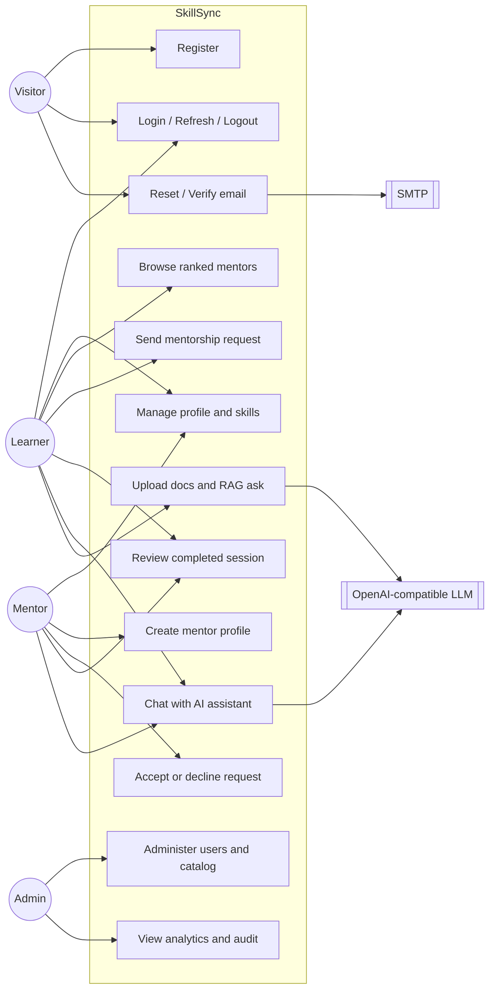

# Use Case Diagram

Actors: **Visitor**, **Learner (USER)**, **Mentor (MENTOR)**, **Admin (ADMIN)**, **Mail server**, **LLM provider**.

Mentors also inherit learner use cases that operate on `profiles`.

## Use case catalog

| ID | Use case | Actor | Precondition | Main flow | Postcondition |
| --- | --- | --- | --- | --- | --- |
| UC-01 | Register | Visitor | Valid unique email | Submit name, email, password, role | User + tokens created |
| UC-02 | Login | Visitor | Enabled account | Email + password | JWT issued; audit login |
| UC-03 | Recover password | Visitor | Known email | Forgot → email → reset | New BCrypt hash |
| UC-04 | Maintain profile | Learner/Mentor | Authenticated | Edit profile and skills | Profile stored in matching DB |
| UC-05 | Get matches | Learner | Profile exists | Open Mentors/Matches | Scored `MentorCard` list |
| UC-06 | Publish mentor card | Mentor | Role MENTOR | Save headline | `mentor_profiles` row |
| UC-07 | Request mentor | Learner | Target accepting | Send message | PENDING request |
| UC-08 | Decide request | Mentor | Owns request | PATCH status | ACCEPTED/DECLINED |
| UC-09 | Review | Learner | COMPLETED request | Rating + comment | Mentor rating updated |
| UC-10 | AI chat | Authenticated | JWT | Message / regenerate | Session messages persisted |
| UC-11 | RAG Q&A | Authenticated | Optional docs | Upload then ask | Chunks + answer |
| UC-12 | Govern users | Admin | ADMIN JWT | Role / enabled | Audit log |
| UC-13 | Inspect platform | Admin | ADMIN JWT | Stats pages | Read-only aggregates |

## Include / extend

- UC-05 **includes** MatchingEngine scoring.
- UC-10 **extends** with SSE stream (`/api/chat/stream`).
- UC-11 **includes** extract → chunk → embed → cosine top-5.
- UC-03 **includes** MailService (best-effort SMTP).
