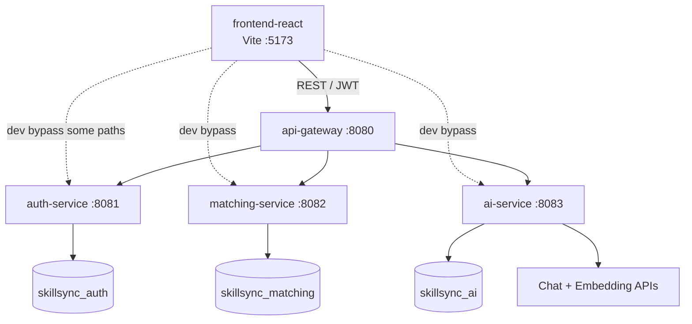
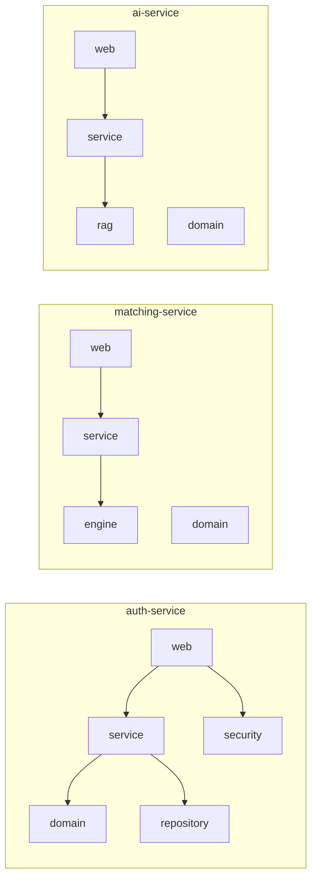
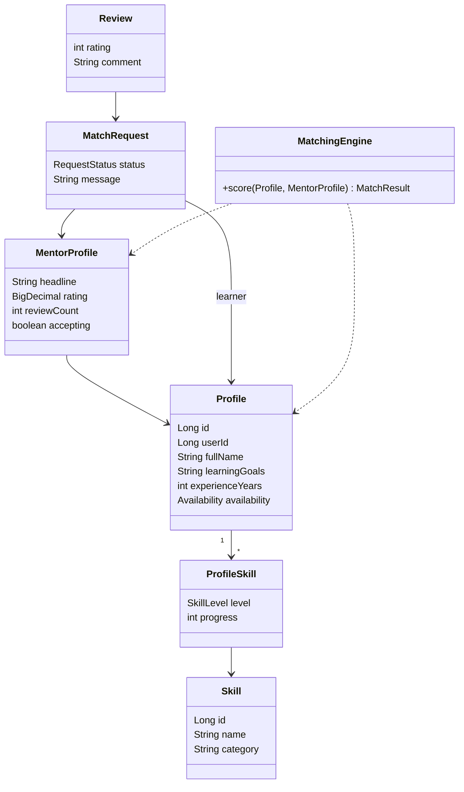
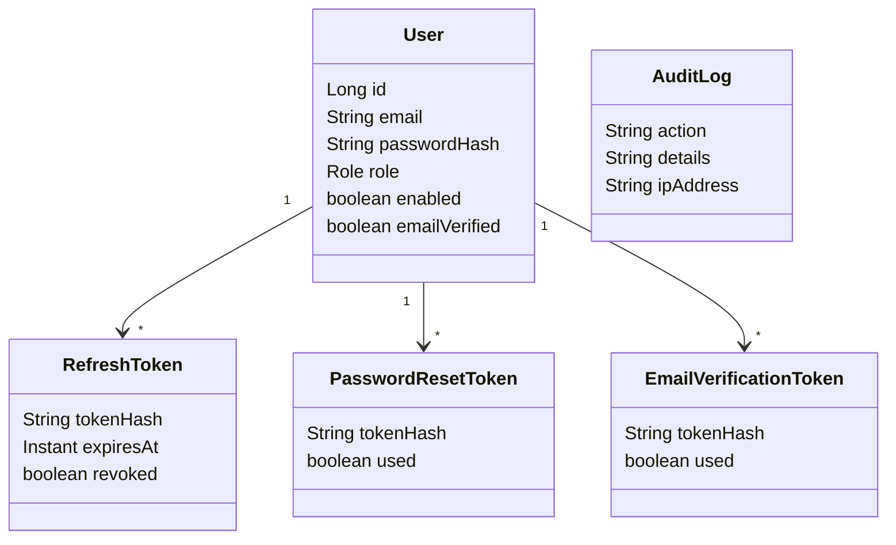
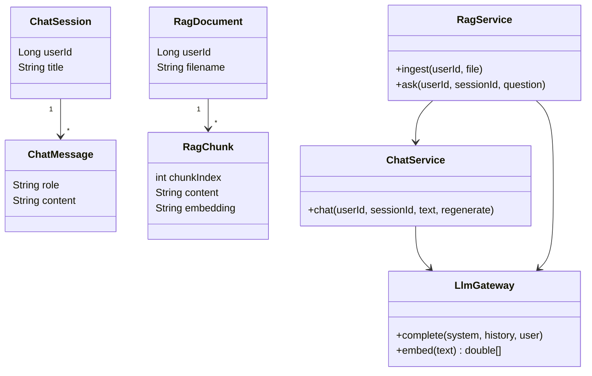
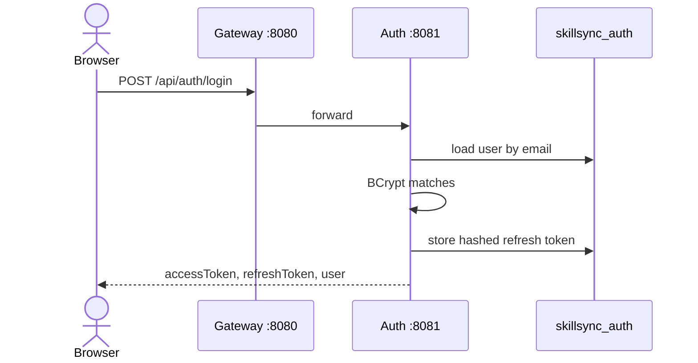
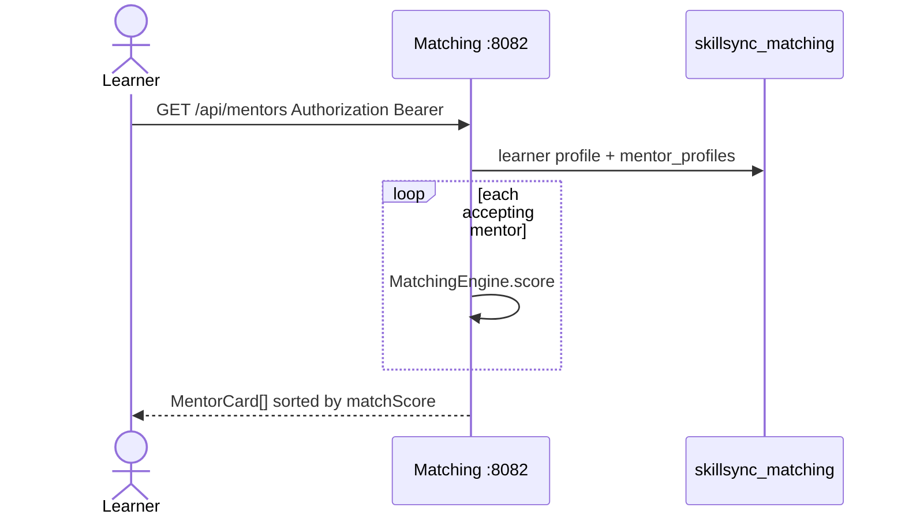
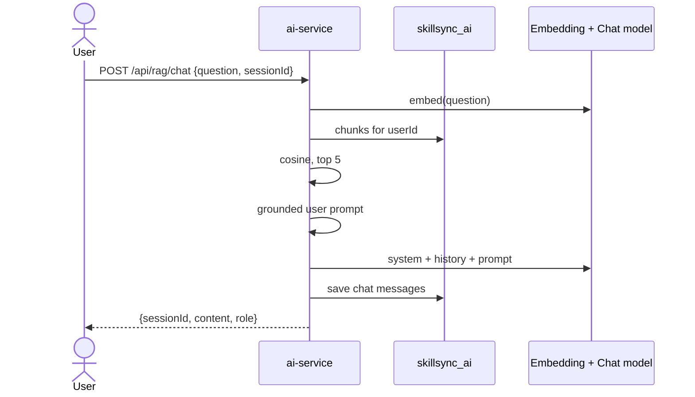
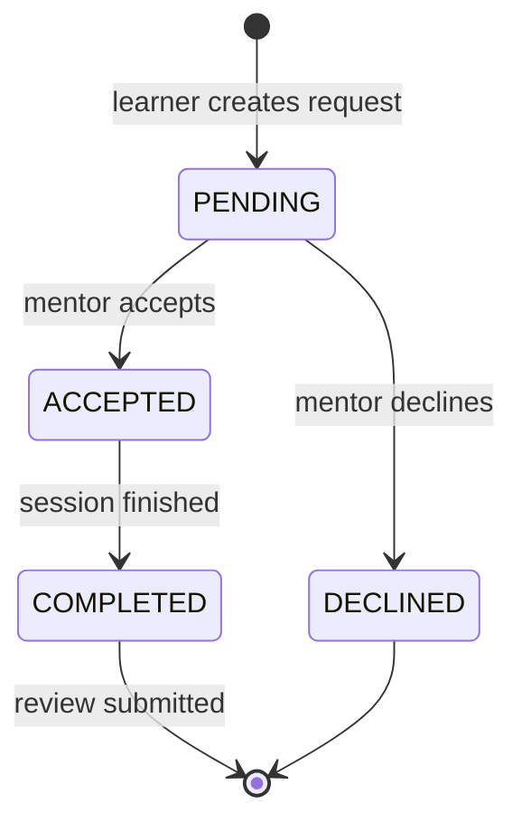
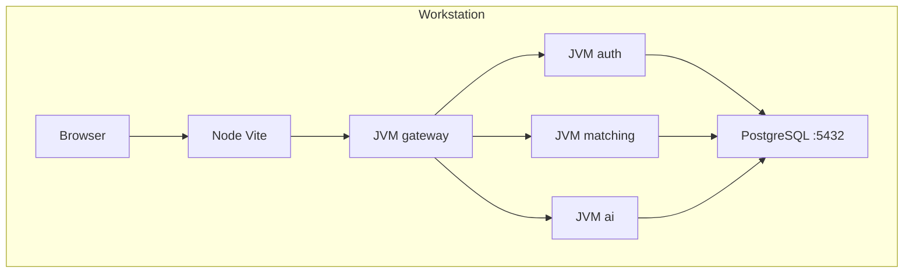

# UML Diagrams

## 1. Component diagram

The frontend `serviceBase()` helper may call 8081/8082/8083 directly in local development while still supporting `VITE_API_BASE_URL=http://localhost:8080`.

## 2. Package diagram (backend)

## 3. Class diagram — matching (simplified)

## 4. Class diagram — auth

## 5. Class diagram — AI / RAG

## 6. Sequence — login

## 7. Sequence — ranked mentors

## 8. Sequence — RAG ask

## 9. Activity — request lifecycle

## 10. Deployment (local)

