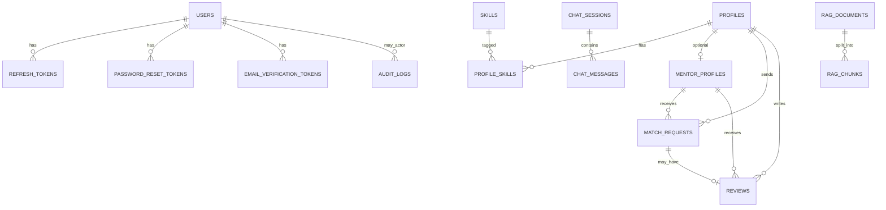
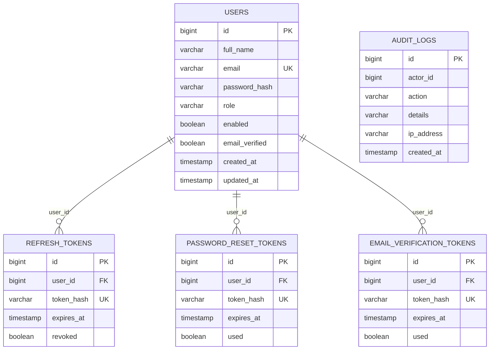
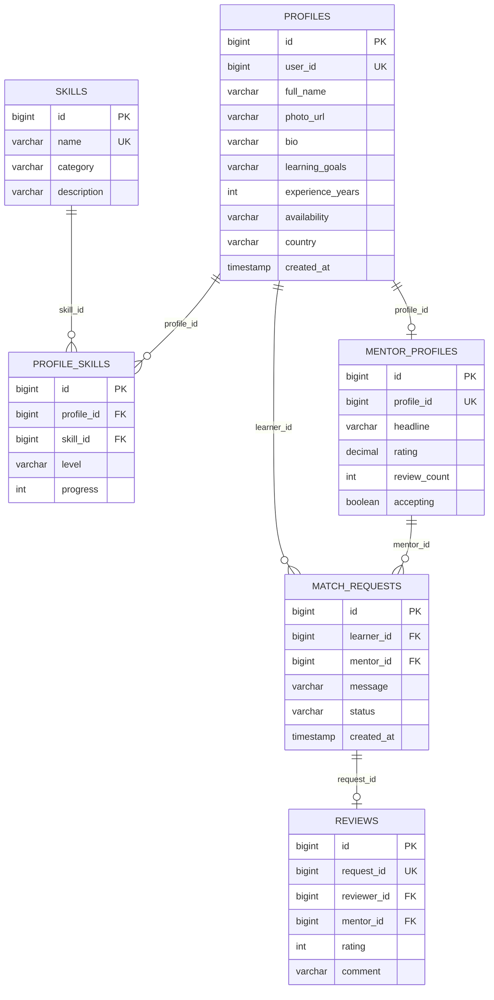
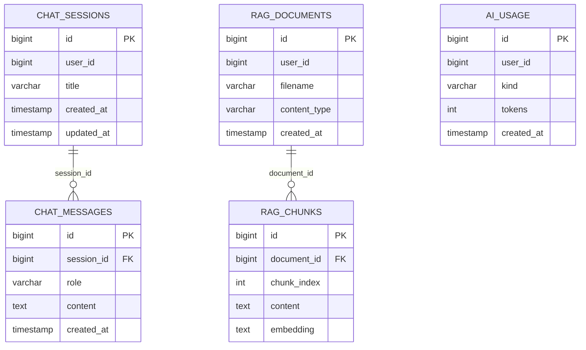

# ER Diagram

SkillSync uses **three PostgreSQL databases**. There are no cross-database foreign keys. `user_id` in matching and AI is a logical reference to `users.id` in auth.

## Conceptual model

## Database: `skillsync_auth`

Flyway: `backend/auth-service/src/main/resources/db/migration/V1__init_auth.sql`

## Database: `skillsync_matching`

Unique `(profile_id, skill_id)` on `profile_skills`.  
Flyway: `V1__init_matching.sql` + `V2__seed_skills.sql`

## Database: `skillsync_ai`

`embedding` is a JSON array of doubles (TEXT), not a native `vector` type.

## Enumerations (application-enforced)

| Enum | Values |
| --- | --- |
| Role | USER, MENTOR, ADMIN |
| Availability | WEEKDAYS, WEEKNIGHTS, WEEKENDS, FLEXIBLE |
| SkillLevel | (JPA enum on profile skills) |
| RequestStatus | PENDING, ACCEPTED, DECLINED, COMPLETED |
| Chat role | `user`, `assistant` |
