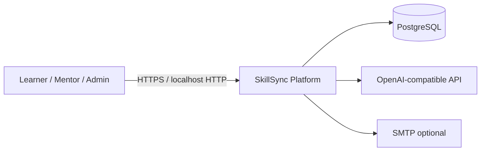
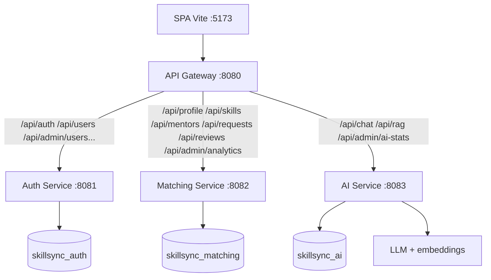
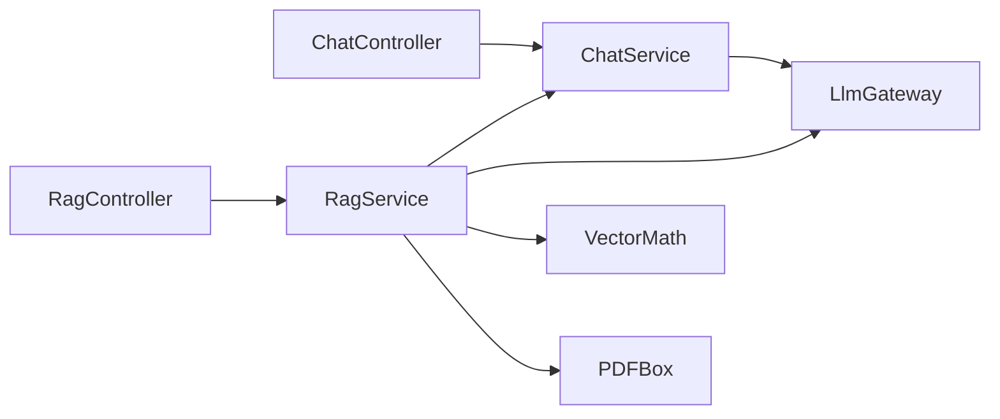

# Architecture Diagram

## C4 — System context



## C4 — Container



## C4 — AI container internals



## Request path (production-style)

```text
Browser
  → Gateway (CORS, rate limit, JWT)
    → Service SecurityFilter (JWT parse, roles)
      → Controller
        → Service
          → JPA / Flyway schema
```

## Matching data flow

```text
Profile + ProfileSkill + Skill
        ↓
MatchingEngine.score
        ↓
MentorCard { matchScore, reasons[] }
        ↓
MentorsPage / MatchesPage
```

## RAG data flow

```text
Multipart PDF/TXT
  → text extract
  → chunk 800 / overlap 120
  → embedding (API or 64-d fallback)
  → rag_chunks.embedding JSON
User question
  → query embedding
  → cosine vs user's chunks
  → top 5
  → grounded prompt
  → LLM + chat_sessions
```

## Network view (local demo)

| Process | Bind |
| --- | --- |
| PostgreSQL | 127.0.0.1:5432 |
| Gateway | :8080 |
| Auth | :8081 |
| Matching | :8082 |
| AI | :8083 |
| Vite | :5173 |

JDBC pattern: `jdbc:postgresql://localhost:5432/{skillsync_auth|skillsync_matching|skillsync_ai}`

## What this architecture deliberately omits

Docker Compose database, Kafka, Redis, Elasticsearch, Pinecone, LangChain, Kubernetes — not required for the current bounded-context HTTP design.
